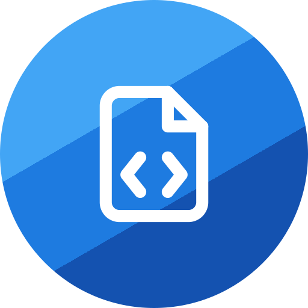

  

<h1 align="center">Meu Editor de Arquivos</h1>

  A lightweight desktop editor for Markdown, code, scripts, logs and configuration files. 
  Windows 11 · Debian · Ubuntu

  <a href="https://meueditordearquivos.aplicativoia.online/?lang=en">Website</a> ·
  <a href="INSTALL.md">Installation</a> ·
  <a href="https://github.com/DiegoMendesRodrigues/Meu-Editor-de-Arquivos/releases">Download</a> ·
  <a href="README.pt-BR.md">Português (Brasil)</a>

---

## About Meu Editor de Arquivos

**Meu Editor de Arquivos** ("My File Editor") is a lightweight desktop editor for developers, system administrators, IT professionals and anyone who works with text files, scripts, logs and source code.

Markdown is the default document format. Markdown files open formatted and remain editable: the toolbar applies headings, lists, indentation, bold, italic, strikethrough, links and tables directly to the formatted text, and one click switches to the plain Markdown source. The application works offline (editing and the local AI assistant included), uses few resources compared with a full IDE, and its interface is available in six languages.

Current version: **1.1.0**.

## Download

- **Windows 11 (64-bit):** [Microsoft Store](https://apps.microsoft.com/detail/9P9LZ413B1XL).
- **Debian 12 and 13, Ubuntu 22.04 and later, and derivatives:** `.deb` package and AppImage on the [GitHub Releases page](https://github.com/DiegoMendesRodrigues/Meu-Editor-de-Arquivos/releases).

Building the Windows installer or portable version yourself is described in [INSTALL.md](INSTALL.md).

## Features

### Editor

- Monaco Editor (the engine behind VS Code), with syntax highlighting, code folding and autocomplete
- Multiple cursors, column (rectangular) selection (also with Shift+Ctrl) and multi-line editing
- Tabs for many open documents, with change indicators
- Go to line, word wrap, adjustable font size and indentation, full screen (F11)
- Show invisible characters (spaces, tabs and line endings)
- Line-number column with colors for both the light and dark modes
- Snippets and macros (record, replay and save), command palette and keyboard shortcuts
- Detects changes made to open files by other programs
- Automatic session recovery: tabs, folder and unsaved text come back when the application reopens

### Documents and sidebar

- Sidebar with explorer, recent files and search
- Sidebar areas collapse with the triangle and can be reordered by dragging their names
- Right-click in the sidebar to rename, color and delete folders and files; file icons by type
- Files dragged from the system file explorer open in the window
- Status bar with line, column, encoding, language, size, line ending and selected characters

### Markdown and JSON

- Markdown opens formatted and editable ([Tiptap](https://tiptap.dev/)), with the formatting toolbar: headings, bulleted and numbered lists, indent and outdent, bold, italic, strikethrough, link, table and clear formatting
- A button switches to the Markdown source as text (Monaco), with the same toolbar and shortcuts (Ctrl+B, Ctrl+I, Ctrl+Shift+X)
- Documents containing HTML are shown read-only in the formatted view, because that editor does not preserve HTML
- JSON viewer with collapsible nodes and the error position for invalid JSON

### Search

- Find and replace in the document, with regular expressions
- Search and replace across a folder, with file filters, running in a worker thread with a time limit

### Text, formatting and encoding tools

- Sort lines, remove duplicate lines, trim trailing spaces, uppercase, lowercase and sentence case, whitespace cleanup
- Offline auto format in each language's standard style: Prettier (with PHP and XML plugins), clang-format, Ruff, gofmt, lua-format, shfmt and sql-formatter
- URL encode and decode, and MD5, SHA-1, SHA-256 and SHA-512 hashes
- UTF-8 and UTF-8 with BOM, and conversion between Windows (CRLF), Unix (LF) and Mac (CR) line endings
- Spell checker (Hunspell in WebAssembly, bundled dictionaries, no internet) in German, English, French, Brazilian Portuguese, European Portuguese and Spanish, for Markdown, text and LaTeX
- Languages: Python, C, C++, C#, Java, JavaScript, TypeScript, PHP, Go, Rust, PowerShell, Bash, Batch, Lua, HTML, CSS, XML, JSON, YAML, TOML, INI, SQL, CSV, LaTeX, Markdown, logs and more

### Integrated terminal

- Terminal below the document (PowerShell on Windows, the user's shell on Linux), opened in the home folder, with up to 10 terminals

### API client

Tools → API Client (Ctrl+Shift+A), or File → New. Requests are JSON documents (`.apireq`); a visual builder edits them and "Edit text" shows the JSON.

- HTTP requests with environments (`.apienv`), collections (on disk or in the cloud), history, cookies, declarative tests and extractions
- Import and export: curl, Postman, OpenAPI, Insomnia, HAR and `.http`; code generation
- Runner with CSV/JSON data and JUnit, HTML and Markdown reports
- OAuth 1.0a and 2.0, GraphQL (including subscriptions), SOAP 1.1/1.2 with WSDL import and XPath
- WebSocket panel, gRPC (the four call types, `.proto` files or reflection) and a local mock server
- Collection monitors (only while the app is open)
- "Before" and "after" scripts in a QuickJS sandbox, with a `pm.*` API
- Secrets (tokens, passwords) live in the system vault and never reach files, the cloud, the session or logs

### Local AI assistant

- Tools → AI Assistant (Ollama), Ctrl+Shift+I: a side panel with streaming chat, quick actions on the selection and insertion at the cursor
- In the API client: "Explain with AI", "Suggest tests" and "Generate documentation with AI"
- Uses only a local [Ollama](https://ollama.com/) (loopback by default; another computer requires an explicit option with a warning). Conversations stay in memory only
- The panel can install Ollama (Windows: official installer, with its Authenticode signature checked; Linux: types the official command in the terminal, without Enter), start it, and download or delete models

### Account and cloud sync (optional)

- Sign-up, profile, password change and password recovery
- Save files to a server to use the same files on several computers; the cloud is the default storage, with folders and a synced workspace
- "Open from cloud" window as a tree, with drag and drop and the full context menu
- Unsaved tabs are synced between computers; when both change the same document, the other version opens in a conflict tab
- Plans: each user belongs to a plan that limits the number of files and the space used. Usage appears in the status bar (orange at 90%, red at 100%), and the server refuses writes beyond the limit, with a notice in the app
- The account API runs on MySQL or MariaDB; see [INSTALL.md](INSTALL.md)

### Interface

- Six languages: German, Spanish, French, English, Brazilian Portuguese and European Portuguese (follows the system language; the flags next to "View" switch it)
- Light and dark modes (follows the system until the user chooses)
- Resizable, hideable sidebar and bottom panel
- Built-in user manual in each language, with screenshots of the application (Help → User manual), and Help → Technical Support

### Security highlights

- Isolated interface: `contextIsolation`, `sandbox`, no `nodeIntegration` and a strict Content Security Policy; the system is reached only through a small preload API
- Files can only be read or written after the user picks them or opens their folder; every IPC call validates its sender and input (Zod)
- The API client keeps all network traffic in the main process and never returns secrets to the interface
- The account server uses scrypt, stores tokens only as hashes, uses parameterized SQL, per-IP rate limits and security headers

## Technologies

| Layer | Technology |
| --- | --- |
| Desktop runtime | [Electron](https://www.electronjs.org/) |
| Language | [TypeScript](https://www.typescriptlang.org/) |
| Interface | [React](https://react.dev/), [Tailwind CSS](https://tailwindcss.com/), [Radix UI](https://www.radix-ui.com/), [Lucide](https://lucide.dev/) icons |
| Code editor | [Monaco Editor](https://microsoft.github.io/monaco-editor/) |
| Formatted Markdown editor | [Tiptap](https://tiptap.dev/) (ProseMirror) |
| Spell checker | [Hunspell](https://hunspell.github.io/) in WebAssembly ([hunspell-asm](https://github.com/kwonoj/hunspell-asm)) with [wooorm/dictionaries](https://github.com/wooorm/dictionaries) |
| Auto format | [Prettier](https://prettier.io/), [@wasm-fmt](https://github.com/wasm-fmt/wasm-fmt) and [sql-formatter](https://github.com/sql-formatter-org/sql-formatter) |
| Terminal | [xterm.js](https://xtermjs.org/) with [node-pty](https://github.com/microsoft/node-pty) |
| API client (main process) | ws, xmldom with xpath, grpc-js with protobufjs, [quickjs-emscripten](https://github.com/justjake/quickjs-emscripten) |
| Local AI | [Ollama](https://ollama.com/) |
| State and panels | [Zustand](https://zustand.docs.pmnd.rs/), [react-resizable-panels](https://github.com/bvaughn/react-resizable-panels) |
| Validation | [Zod](https://zod.dev/) |
| Build | [Vite](https://vite.dev/) with [electron-vite](https://electron-vite.org/) |
| Packaging | [electron-builder](https://www.electron.build/) (NSIS, portable, AppX for the Microsoft Store, DEB, AppImage) |
| Logs | [electron-log](https://github.com/megahertz/electron-log) |
| Tests | [Vitest](https://vitest.dev/) (unit) and [Playwright](https://playwright.dev/) (interface) |
| Account API | [Fastify](https://fastify.dev/) with [MySQL](https://www.mysql.com/) / [MariaDB](https://mariadb.org/) |

## Installation

See **[INSTALL.md](INSTALL.md)** for the development environment, building and distributing the application, and setting up the account server.

## GitHub

- Repository: [github.com/DiegoMendesRodrigues/Meu-Editor-de-Arquivos](https://github.com/DiegoMendesRodrigues/Meu-Editor-de-Arquivos)
- Downloads: [Releases](https://github.com/DiegoMendesRodrigues/Meu-Editor-de-Arquivos/releases)
- Bug reports and suggestions: [Issues](https://github.com/DiegoMendesRodrigues/Meu-Editor-de-Arquivos/issues)
- Website: [meueditordearquivos.aplicativoia.online](https://meueditordearquivos.aplicativoia.online/?lang=en)
- License: [MIT](LICENSE) (Portuguese translation: [LICENSE.pt-BR.md](LICENSE.pt-BR.md))
- Contact: suporte@meueditordearquivos.aplicativoia.online

> Treat this project as a prototype until an experienced delivery professional reviews the architecture, tests and best practices.

## Developer

Developed by **[Diego Mendes Rodrigues](https://www.linkedin.com/in/diegomendesrodrigues/)**.
