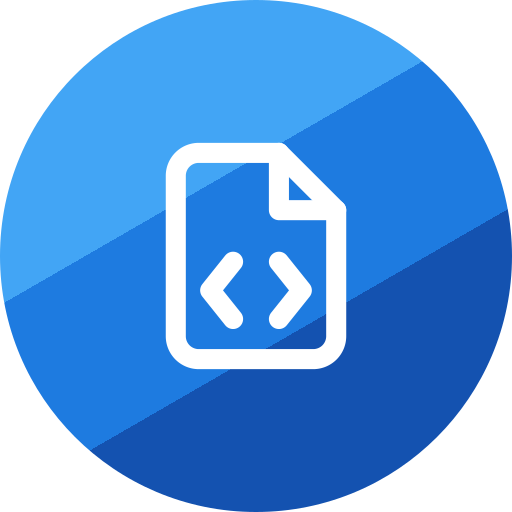

  

<h1 align="center">Meu Editor de Arquivos</h1>

  Editor leve para desktop de Markdown, código, scripts, logs e arquivos de configuração. 
  Windows 11 · Debian · Ubuntu

  <a href="https://meueditordearquivos.aplicativoia.online/?lang=pt-BR">Site</a> ·
  <a href="INSTALL.pt-BR.md">Instalação</a> ·
  <a href="https://github.com/DiegoMendesRodrigues/Meu-Editor-de-Arquivos/releases">Download</a> ·
  <a href="README.md">English</a>

---

## Sobre o Meu Editor de Arquivos

O **Meu Editor de Arquivos** é um editor leve para desktop, feito para desenvolvedores, administradores de sistemas, profissionais de TI e todos que trabalham com arquivos de texto, scripts, logs e códigos de programação.

O Markdown é o formato padrão de documento. Os arquivos Markdown abrem formatados e continuam editáveis: a barra de ferramentas aplica títulos, listas, recuos, negrito, itálico, tachado, links e tabelas direto no texto formatado, e um clique alterna para o código Markdown. O aplicativo funciona sem internet (edição e assistente de IA local incluídos), consome poucos recursos em comparação com uma IDE completa e tem a interface em seis idiomas.

Versão atual: **1.1.0**.

## Download

- **Windows 11 (64 bits):** [Microsoft Store](https://apps.microsoft.com/detail/9P9LZ413B1XL).
- **Debian 12 e 13, Ubuntu 22.04 e posteriores, e derivadas:** pacote `.deb` e AppImage na [página de Releases do GitHub](https://github.com/DiegoMendesRodrigues/Meu-Editor-de-Arquivos/releases).

Para gerar você mesmo o instalador ou a versão portátil do Windows, veja [INSTALL.pt-BR.md](INSTALL.pt-BR.md).

## Funcionalidades

### Editor

- Monaco Editor (o motor do VS Code), com realce de sintaxe, recolhimento de blocos e autocompletar
- Múltiplos cursores, seleção por coluna (retangular, também com Shift+Ctrl) e edição em várias linhas
- Abas para vários documentos abertos, com indicador de alterações
- Ir para a linha, quebra de linha, tamanho da fonte e recuo ajustáveis, tela inteira (F11)
- Exibição de caracteres invisíveis (espaços, tabulações e finais de linha)
- Coluna dos números de linha com cores nos modos claro e escuro
- Snippets e macros (gravar, repetir e salvar), paleta de comandos e atalhos de teclado
- Detecta alterações feitas nos arquivos abertos por outros programas
- Recuperação automática da sessão: abas, pasta e texto não salvo voltam ao reabrir o aplicativo

### Documentos e barra lateral

- Barra lateral com explorador, arquivos recentes e busca
- As áreas da barra lateral recolhem pelo triângulo e podem ser reordenadas arrastando o nome
- Botão direito na barra lateral para renomear, colorir e excluir pastas e arquivos; ícones por tipo de arquivo
- Arquivos arrastados do explorador do sistema abrem na janela
- Barra de status com linha, coluna, codificação, linguagem, tamanho, final de linha e caracteres selecionados

### Markdown e JSON

- O Markdown abre formatado e editável ([Tiptap](https://tiptap.dev/)), com a barra de formatação: títulos, listas com marcadores e numeradas, aumentar e diminuir recuo, negrito, itálico, tachado, link, tabela e remover formatação
- Um botão alterna para o Markdown como texto (Monaco), com a mesma barra e os mesmos atalhos (Ctrl+B, Ctrl+I, Ctrl+Shift+X)
- Documentos com HTML aparecem só para leitura na visualização formatada, porque esse editor não preserva HTML
- Visualizador de JSON com nós que abrem e fecham e a posição do erro em JSON inválido

### Busca

- Localizar e substituir no documento, com expressões regulares
- Busca e substituição em uma pasta, com filtros de arquivos, executadas numa thread com tempo limite

### Ferramentas de texto, formatação e codificação

- Ordenar linhas, remover linhas duplicadas, remover espaços no fim da linha, maiúsculas, minúsculas e primeira letra maiúscula, limpeza de espaços
- Auto formatação offline no estilo padrão de cada linguagem: Prettier (com plugins PHP e XML), clang-format, Ruff, gofmt, lua-format, shfmt e sql-formatter
- Codificar e decodificar URL, e hashes MD5, SHA-1, SHA-256 e SHA-512
- UTF-8 e UTF-8 com BOM, e conversão entre finais de linha Windows (CRLF), Unix (LF) e Mac (CR)
- Corretor ortográfico (Hunspell em WebAssembly, dicionários embutidos, sem internet) em alemão, inglês, francês, português do Brasil, português de Portugal e espanhol, para Markdown, texto e LaTeX
- Linguagens: Python, C, C++, C#, Java, JavaScript, TypeScript, PHP, Go, Rust, PowerShell, Bash, Batch, Lua, HTML, CSS, XML, JSON, YAML, TOML, INI, SQL, CSV, LaTeX, Markdown, logs e outras

### Terminal integrado

- Terminal abaixo do documento (PowerShell no Windows, o shell do usuário no Linux), aberto na pasta pessoal, com até 10 terminais

### Cliente de API

Ferramentas → Cliente de API (Ctrl+Shift+A), ou Arquivo → Novo. As requisições são documentos JSON (`.apireq`); um construtor visual as edita e "Editar texto" mostra o JSON.

- Requisições HTTP com ambientes (`.apienv`), coleções (no disco ou na nuvem), histórico, cookies, testes declarativos e extrações
- Importar e exportar: curl, Postman, OpenAPI, Insomnia, HAR e `.http`; geração de código
- Executor com dados CSV/JSON e relatórios JUnit, HTML e Markdown
- OAuth 1.0a e 2.0, GraphQL (com subscriptions), SOAP 1.1/1.2 com importação de WSDL e XPath
- Painel WebSocket, gRPC (os quatro tipos de chamada, arquivos `.proto` ou reflexão) e servidor mock local
- Monitores de coleções (só com o aplicativo aberto)
- Scripts "antes" e "depois" em sandbox QuickJS, com a API `pm.*`
- Os segredos (tokens, senhas) ficam no cofre do sistema e nunca vão para arquivos, nuvem, sessão ou logs

### Assistente de IA local

- Ferramentas → Assistente de IA (Ollama), Ctrl+Shift+I: painel lateral com conversa em streaming, ações rápidas sobre a seleção e inserção no cursor
- No Cliente de API: "Explicar com IA", "Sugerir testes" e "Gerar documentação com IA"
- Usa só um [Ollama](https://ollama.com/) local (loopback por padrão; outro computador exige uma opção explícita com aviso). A conversa fica só na memória
- O painel instala o Ollama (Windows: instalador oficial, com a assinatura Authenticode conferida; Linux: digita o comando oficial no terminal, sem Enter), inicia o serviço e baixa ou exclui modelos

### Conta e sincronização na nuvem (opcional)

- Cadastro, perfil, troca e recuperação de senha
- Gravação de arquivos em um servidor para usar os mesmos arquivos em vários computadores; a nuvem é o armazenamento padrão, com pastas e área de trabalho sincronizada
- Janela "Abrir da nuvem" em árvore, com arrastar e soltar e o menu de contexto completo
- As abas não salvas são sincronizadas entre computadores; se os dois alterarem o mesmo documento, a outra versão abre numa aba de conflito
- Planos: cada usuário pertence a um plano que limita o número de arquivos e o espaço usado. O uso aparece na barra de status (laranja a 90%, vermelho a 100%), e o servidor recusa gravações além do limite, com um aviso no aplicativo
- A API da conta roda em MySQL ou MariaDB; veja [INSTALL.pt-BR.md](INSTALL.pt-BR.md)

### Interface

- Seis idiomas: alemão, espanhol, francês, inglês, português do Brasil e português de Portugal (segue o idioma do sistema; as bandeiras ao lado de "Visualizar" trocam o idioma)
- Modos claro e escuro (segue o sistema até o usuário escolher)
- Barra lateral e painel inferior redimensionáveis e ocultáveis
- Manual do usuário embutido em cada idioma, com telas do aplicativo (Ajuda → Manual do usuário), e Ajuda → Suporte Técnico

### Destaques de segurança

- Interface isolada: `contextIsolation`, `sandbox`, sem `nodeIntegration` e com Content Security Policy restrita; o sistema só é acessado por uma pequena API de preload
- Arquivos só são lidos ou gravados depois que o usuário os escolhe ou abre a pasta deles; todo IPC valida o remetente e a entrada (Zod)
- O Cliente de API mantém toda a rede no processo principal e nunca devolve segredos à interface
- O servidor de contas usa scrypt, guarda tokens só como hash, SQL parametrizado, limites por IP e cabeçalhos de segurança

## Tecnologias

| Camada | Tecnologia |
| --- | --- |
| Runtime desktop | [Electron](https://www.electronjs.org/) |
| Linguagem | [TypeScript](https://www.typescriptlang.org/) |
| Interface | [React](https://react.dev/), [Tailwind CSS](https://tailwindcss.com/), [Radix UI](https://www.radix-ui.com/), ícones [Lucide](https://lucide.dev/) |
| Editor de código | [Monaco Editor](https://microsoft.github.io/monaco-editor/) |
| Editor de Markdown formatado | [Tiptap](https://tiptap.dev/) (ProseMirror) |
| Corretor ortográfico | [Hunspell](https://hunspell.github.io/) em WebAssembly ([hunspell-asm](https://github.com/kwonoj/hunspell-asm)) com [wooorm/dictionaries](https://github.com/wooorm/dictionaries) |
| Auto formatação | [Prettier](https://prettier.io/), [@wasm-fmt](https://github.com/wasm-fmt/wasm-fmt) e [sql-formatter](https://github.com/sql-formatter-org/sql-formatter) |
| Terminal | [xterm.js](https://xtermjs.org/) com [node-pty](https://github.com/microsoft/node-pty) |
| Cliente de API (processo principal) | ws, xmldom com xpath, grpc-js com protobufjs, [quickjs-emscripten](https://github.com/justjake/quickjs-emscripten) |
| IA local | [Ollama](https://ollama.com/) |
| Estado e painéis | [Zustand](https://zustand.docs.pmnd.rs/), [react-resizable-panels](https://github.com/bvaughn/react-resizable-panels) |
| Validação | [Zod](https://zod.dev/) |
| Build | [Vite](https://vite.dev/) com [electron-vite](https://electron-vite.org/) |
| Empacotamento | [electron-builder](https://www.electron.build/) (NSIS, portátil, AppX para a Microsoft Store, DEB, AppImage) |
| Logs | [electron-log](https://github.com/megahertz/electron-log) |
| Testes | [Vitest](https://vitest.dev/) (unitários) e [Playwright](https://playwright.dev/) (interface) |
| API de contas | [Fastify](https://fastify.dev/) com [MySQL](https://www.mysql.com/) / [MariaDB](https://mariadb.org/) |

## Instalação

Veja **[INSTALL.pt-BR.md](INSTALL.pt-BR.md)** para o ambiente de desenvolvimento, a geração e distribuição do aplicativo e a instalação do servidor de contas.

## GitHub

- Repositório: [github.com/DiegoMendesRodrigues/Meu-Editor-de-Arquivos](https://github.com/DiegoMendesRodrigues/Meu-Editor-de-Arquivos)
- Downloads: [Releases](https://github.com/DiegoMendesRodrigues/Meu-Editor-de-Arquivos/releases)
- Relatos de problemas e sugestões: [Issues](https://github.com/DiegoMendesRodrigues/Meu-Editor-de-Arquivos/issues)
- Site: [meueditordearquivos.aplicativoia.online](https://meueditordearquivos.aplicativoia.online/?lang=pt-BR)
- Licença: [MIT](LICENSE) (tradução em português: [LICENSE.pt-BR.md](LICENSE.pt-BR.md))
- Contato: suporte@meueditordearquivos.aplicativoia.online

> Trate este projeto como um protótipo até que um profissional experiente em entregas avalie a arquitetura, os testes e as boas práticas.

## Desenvolvedor

Desenvolvido por **[Diego Mendes Rodrigues](https://www.linkedin.com/in/diegomendesrodrigues/)**.
